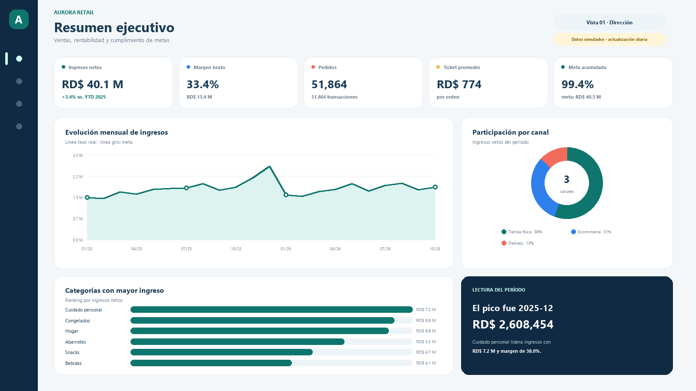
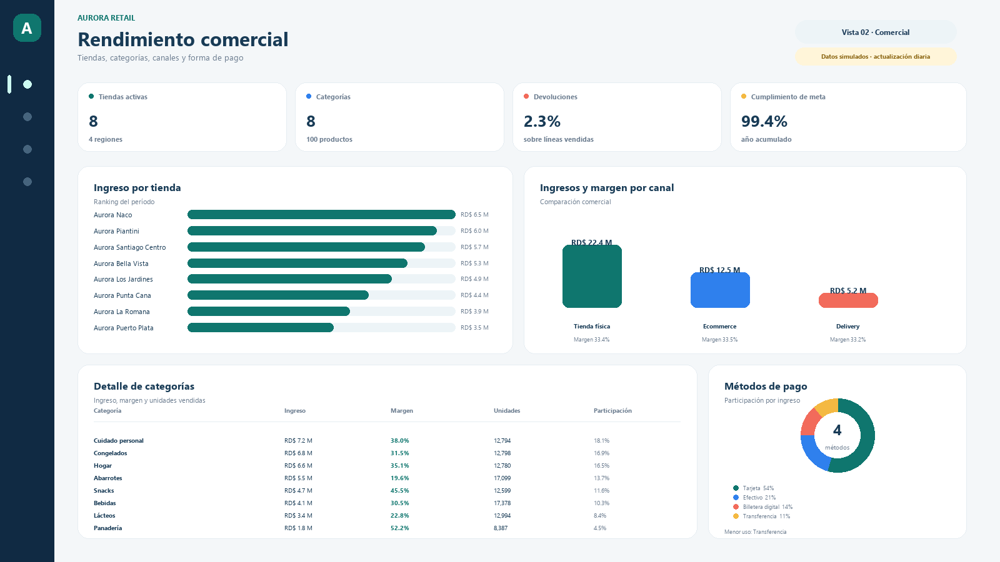
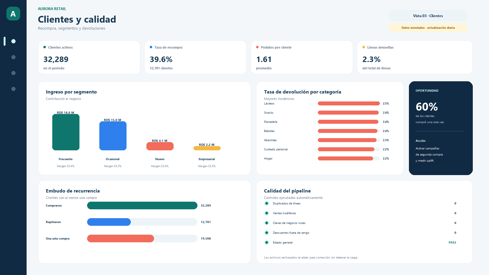
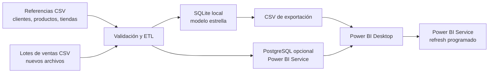

# Aurora Retail · Proyecto BI de ventas

[](https://github.com/xsmvth/aurora-retail-powerbi/actions/workflows/tests.yml)

[Ver la presentación interactiva](https://aurora-retail-powerbi.vercel.app)

Caso de portafolio end-to-end para una cadena ficticia de retail: generación y
recepción de datos, validación de calidad, almacén analítico, modelo estrella y
diseño de un tablero ejecutivo en Power BI con actualización programada.

> **Aviso:** Aurora Retail, sus clientes y sus transacciones son ficticios. El
> dataset fue creado para demostrar el flujo completo sin usar información
> confidencial.



## Resultados del escenario

Período: enero 2025 a octubre 2026.

| Indicador | Valor |
|---|---:|
| Ingresos netos | RD$ 40.1 M |
| Utilidad bruta | RD$ 13.4 M |
| Margen bruto | 33.4 % |
| Pedidos | 51,864 |
| Ticket promedio | RD$ 774 |
| Clientes activos | 32,289 |
| Tasa de recompra | 39.6 % |
| Cumplimiento de meta | 99.4 % |
| Líneas devueltas | 2.3 % |

El volumen del almacén es de **91,412 líneas de venta**, **60,000 clientes**,
**100 productos**, **8 tiendas** y **528 metas** tienda-canal-mes.

## Vista del proyecto

| Resumen ejecutivo | Rendimiento comercial |
|---|---|
|  |  |



Las imágenes anteriores son la referencia visual del informe que se construye
en Power BI con la guía incluida.

## Qué demuestra

- Diseño de un modelo estrella con hechos de ventas y metas.
- ETL incremental e idempotente por archivo y por `sale_line_id`.
- Validación de nulos, claves huérfanas, duplicados, descuentos y devoluciones.
- Separación entre SQLite local y PostgreSQL opcional para actualización cloud.
- Medidas DAX de ingresos, margen, ticket, recompra, devoluciones y time intelligence.
- Storytelling ejecutivo, recomendaciones accionables y guion de entrevista.
- Automatización en Windows con PowerShell y Task Scheduler.

## Arquitectura



El detalle técnico está en [docs/ARQUITECTURA.md](docs/ARQUITECTURA.md).

## Inicio rápido

Requisitos: Python 3.11+ y Power BI Desktop.

```powershell
python -m venv .venv
.\.venv\Scripts\Activate.ps1
pip install -r pipeline\requirements.txt
.\scripts\actualizar_datos.ps1
```

El comando genera la base `data/warehouse/aurora_retail.db`, las tablas
listas para Power BI en `data/export/`, el reporte de calidad y los hallazgos.
Esos artefactos se regeneran localmente y no se versionan en Git para mantener
el repositorio liviano y evitar publicar datos derivados obsoletos.

Si quieres regenerar también los archivos fuente simulados:

```powershell
python pipeline\generate_demo_data.py
```

Luego sigue [powerbi/GUIA_POWER_BI.md](powerbi/GUIA_POWER_BI.md) para montar el
modelo, publicar y programar el refresh. Las medidas están en
[powerbi/medidas.dax](powerbi/medidas.dax) y el tema visual en
[powerbi/AuroraRetail_Theme.json](powerbi/AuroraRetail_Theme.json).

## Agregar nuevos datos

1. Coloca un CSV nuevo en `data/landing/sales/`.
2. Usa las mismas columnas que los lotes existentes.
3. Ejecuta `scripts/actualizar_datos.ps1`.
4. En Power BI Desktop pulsa **Actualizar**.

El pipeline procesa únicamente archivos nuevos o modificados. Un reintento no
duplica ventas porque los hechos se actualizan por `sale_line_id`. Consulta el
contrato completo en [docs/COMO_AGREGAR_DATOS.md](docs/COMO_AGREGAR_DATOS.md).

## Documentación

- [Guía para construir el informe en Power BI](powerbi/GUIA_POWER_BI.md)
- [Caso de estudio para portafolio](docs/CASO_DE_ESTUDIO.md)
- [Arquitectura y operación](docs/ARQUITECTURA.md)
- [Diccionario de datos](docs/DICCIONARIO_DATOS.md)
- [Cómo agregar o reemplazar datos](docs/COMO_AGREGAR_DATOS.md)
- [Hallazgos del análisis](docs/HALLAZGOS.md)
- [Guion para presentar el proyecto](docs/GUION_PORTAFOLIO.md)
- [Reporte de calidad](data/quality/data_quality_report.md)

## Estructura

```text
aurora-retail-powerbi-portfolio/
├── data/
│   ├── raw/reference/       # Dimensiones y metas
│   ├── landing/sales/       # Lotes transaccionales
│   ├── warehouse/           # SQLite generado
│   ├── export/              # Entrada para Power BI
│   └── quality/             # Controles y filas rechazadas
├── database/                # DDL SQLite/PostgreSQL y Docker Compose
├── pipeline/                # Generación, ETL, análisis y capturas
├── powerbi/                 # Guía, tema y medidas DAX
├── scripts/                 # Actualización manual y programada
├── screenshots/             # Referencia visual del tablero
├── tests/                   # Prueba del modelo y la integridad
└── docs/                    # Caso, arquitectura y diccionario
```

## Nota sobre el archivo de Power BI

El paquete no incluye un `.pbix` precompilado porque Power BI Desktop no estaba
disponible en el entorno de construcción. Incluye todo el trabajo reproducible:
dataset, modelo, relaciones, medidas, tema, especificación visual y proceso de
publicación. La guía permite crear el informe final en Power BI Desktop y
guardarlo con el nombre `Aurora_Retail.pbix`.

## Reproducibilidad

El repositorio incluye únicamente los datos fuente ficticios y todo el código
necesario para reconstruir el almacén y los archivos de consumo. Para validar la
ETL desde cero:

```powershell
python -m unittest discover -s tests -v
```
