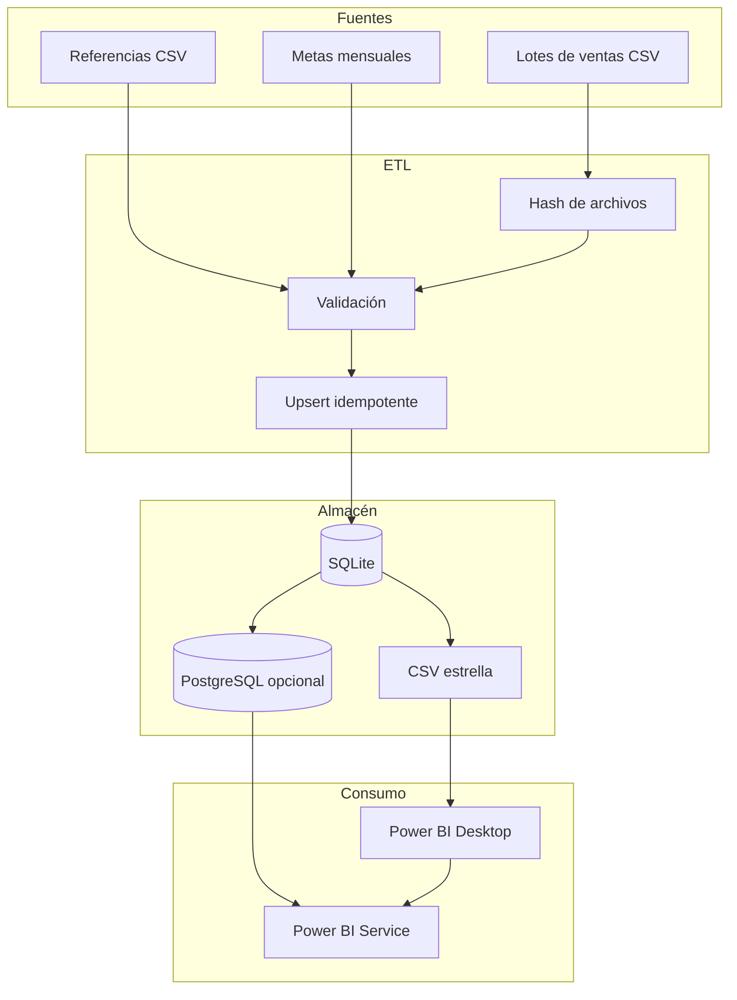

# Arquitectura y operación

## Flujo de datos



## Decisión de diseño

**SQLite local** hace que el proyecto sea inmediatamente reproducible y no exige
instalar un servidor. Es el almacén de desarrollo y la fuente de verdad del
portafolio.

**PostgreSQL** es la ruta opcional para producción y para actualización cloud.
Power BI Service necesita conectarse a un origen accesible desde Internet; si se
usa SQLite o una carpeta local, se requiere un gateway de datos local.

**CSV de exportación** permite demostrar el proyecto en Power BI Desktop sin
bloquear al evaluador por credenciales o infraestructura. Se generan de forma
atómica para evitar que Power BI lea archivos parcialmente escritos.

## Idempotencia

El ETL calcula SHA-256 para cada lote de ventas:

- Si el hash ya fue procesado, omite el archivo.
- Si el archivo cambia o es nuevo, lo valida y procesa.
- Las ventas se actualizan por `sale_line_key`.
- Las dimensiones y metas se actualizan por sus claves naturales.

Esto permite reintentos seguros y cargas incrementales.

## Calidad

Antes de cargar hechos se comprueba:

- columnas obligatorias;
- claves nulas o duplicadas;
- cliente, producto, tienda o canal inexistente;
- descuentos fuera de `0–0.95`;
- cantidad cero, precio/costo negativos;
- inconsistencias entre `is_return` y el signo de la cantidad.

Las filas inválidas se aíslan en `data/quality/rejected_rows.csv`. La ejecución
también registra controles en `data/quality/data_quality_report.json` y
`data/quality/data_quality_report.md`.

## Automatización

Ejecución manual:

```powershell
.\scripts\actualizar_datos.ps1
```

Programación diaria a las 06:00:

```powershell
.\scripts\programar_actualizacion.ps1 -Hora "06:00"
```

Después se programa Power BI Service a las 06:30. Así el informe consume datos
ya validados y actualizados.

## Seguridad

- No hay nombres, documentos, direcciones ni datos personales reales.
- Las credenciales se reciben por `DATABASE_URL`; nunca se incluyen en el repo.
- `.env` está excluido por `.gitignore`.
- Para producción se recomienda usuario de base de datos de solo lectura para
  Power BI y usuario ETL separado.
